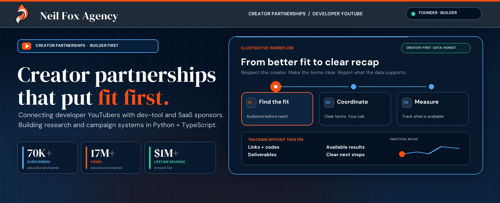

  

  <a href="https://neilfoxagency.com">Website</a> ·
  <a href="https://neilfoxagency.com/for-youtubers">For YouTube creators</a> ·
  <a href="https://neilfoxagency.com/for-brands">For brands</a> ·
  <a href="mailto:partnerships@neilfoxagency.com">Email Neil</a> ·
  <a href="https://x.com/itsneilfox">X</a> ·
  <a href="https://www.linkedin.com/in/jeffery-neil-wacaster-90b572336">LinkedIn</a>

---

### Hey, I'm Neil 👋

I run [Neil Fox Agency](https://neilfoxagency.com), a small sponsorship agency for YouTube creators. My current focus is developer channels and the dev-tool and SaaS companies that want to reach them. I'm a builder first: the agency runs on creator discovery, sponsor research, email verification, and campaign tools I write in Python and TypeScript.

If you got an email from me, this is probably why.

| 70K+ | 17M+ | $1M+ |
|:---:|:---:|:---:|
| subscribers on my educational channel | channel views | ArtworkTee lifetime revenue |

### For developer YouTubers

Developer audiences are small, technical, and hard to reach—which can make them valuable to the right sponsor. You don't need 100K subscribers; a focused channel with 1,000+ engaged developers can land paid integrations, dedicated videos, or ad creative for tools your viewers would actually use.

- I find sponsors that fit your content; I won't pitch products you'd be embarrassed to show.
- I handle outreach, negotiation, and paperwork.
- You keep creative control and approve every deal.

I've been on your side of this. I grew an educational channel to 70K+ subscribers and 17M+ views, so I know what a bad sponsor brief feels like.

### For dev-tool and SaaS teams

If you're launching, trending on GitHub, or trying to get in front of engineers without burning money on ads they block, I'll match you with developer channels whose viewers could be your users-in-waiting—from niche specialists to bigger names—and coordinate the campaign end to end.

### A few things I've built

- [creator-deal-math](https://github.com/NeilFoxAgency/creator-deal-math) — quick math for sponsorship pricing.
- [youtube-disclosure-check](https://github.com/NeilFoxAgency/youtube-disclosure-check) — a pre-publish sponsor disclosure check.
- [creator-link-kit](https://github.com/NeilFoxAgency/creator-link-kit) — practical link tooling for creators.

Before the agency, I built and ran ArtworkTee.com to $1M+ in lifetime revenue.

### Say hi

📬 [partnerships@neilfoxagency.com](mailto:partnerships@neilfoxagency.com) · 🌐 [neilfoxagency.com](https://neilfoxagency.com) · 🐦 [@itsneilfox](https://x.com/itsneilfox) · 💼 [LinkedIn](https://www.linkedin.com/in/jeffery-neil-wacaster-90b572336)

Based in Kissimmee, Florida. Happy to talk shop even if a deal isn't a fit.
